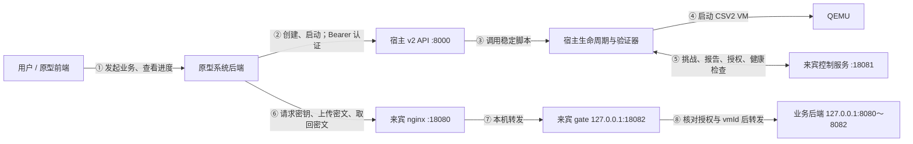

# CSV2 子后端与原型系统对接手册

> **适用范围**：当前稳定版 v2 宿主 API、CSV2 证明网关和 `service_new.tar.gz` 业务服务。  
> **用途**：原型系统前后端开发、接口迁移、联调和验收。  
> **核对日期**：2026-10-06。本文依据本机源码和正式发布清单编写；响应中的 VM ID、时间和密文均为示例，不是本次实机测试记录。  
> **阅读顺序**：先看第 1～2 节确定接入边界，再按第 3～5 节开发，最后执行第 6 节测试。第 7 节列出联调问题及修复状态；密钥路径问题已完成两次实机启动验收。

## 1. 谁调用谁

原型系统代表用户侧客户端，CSV2 子后端负责创建与启动虚拟机、验证启动基线、自动完成远程证明，以及在来宾中执行已有业务。**原型系统仍调用原有 v2 和业务接口，不需要调用 CSV2 证明控制端口，也不需要映射 18082。**



图中的 18080 由宿主 QEMU 转发到来宾；18081 在宿主只绑定 `127.0.0.1`。18082 和 8080～8082 都是来宾内的回环地址，原型系统只接入下面两个地址：

| 配置项 | 示例 | 调用者和用途 |
|---|---|---|
| `CONTROL_BASE_URL` | `http://<海光宿主地址>:8000` | 原型后端创建、启动 VM |
| `BUSINESS_BASE_URL` | `http://<海光宿主地址>:18080` | 用户侧客户端经原型系统调用业务 |
| `VM_API_TOKEN` | 由海光侧通过安全渠道交付 | 原型后端访问宿主 API 的凭据；不交给浏览器 |

地址由部署人员确认。API 程序默认监听 `127.0.0.1:8000`，实际服务可以通过启动参数或代理使用其他监听地址；不能把源码默认值当作现场可达地址。当前代码没有内建 HTTPS，正式接入需要沿用原型系统已有的受保护网络或 HTTPS 代理。业务端口没有校验宿主 Bearer token，不能把设置了 `Authorization` 头误认为已完成业务用户认证。

**角色分工**：海光侧管理主机、VM、基线、官方证书验证和 vTKM；原型后端负责用户权限、业务任务与 VM ID 的对应、调用顺序、超时处理和向前端反馈。加密和解密由持有 EC 私钥的用户侧组件完成。本手册的测试程序模拟该组件；若原型后端代做，则后端属于用户信任范围，会接触明文及业务密钥。若原型原来在浏览器或客户端加密，应保留该位置，后端只转发公钥、密文和结果，不能为了对接把私钥搬到海光宿主。

## 2. 相比原有调用方式，哪些要改

本文以当前未改写的业务压缩包及旧客户端示例为比较依据。未取得原型系统仓库，下面列的是需要原型团队核对的适配项，不表示已经修改了原型代码。

| 项目 | 当前行为 | 原型系统动作 |
|---|---|---|
| 创建和启动路径 | 仍为 `/api/v2/vms` 和 `/api/v2/vms/<vmId>/start` | 保留现有调用路径 |
| 默认资源与系统盘 | 仍为 8 核、4096 MB；复制独立的母版系统盘 | 不需要上传系统盘或改成无盘工作流 |
| 创建时的度量准备 | 选择已签名发布并校验输入；不在每次创建时重打 initramfs 或登记新基线 | 不增加客户端打包步骤 |
| `vmId` | 创建接口返回 16 位小写十六进制 ID；gate 要求每次请求匹配它 | 删除 `vm-test-001` 等固定示例 ID；禁止用订单号替代 |
| 业务入口 | 仍用宿主 18080；内部增加 gate 18082 | 不新增 18082 的外部映射 |
| 启动完成的含义 | 等待依赖与业务服务就绪，再做证明、授权和健康校验 | 保留等待界面；启动“通过”后再允许上传 |
| 证明结果 | 启动响应增加 `remoteAttestation` | 解析、保存并反馈给前端 |
| 客户报告导出 | 尚未提供独立导出路由；业务响应也没有自动增加证明字段 | 不调用假设存在的 `/attestation` 接口，不读取宿主私有文件 |
| 密钥协议 | 保留 P-256 ECDH + SHA-256 + AES-GCM 的 HENC2 JSON 封装；底层改为正确的 vTKM 生钥与解包 | 保留客户端 EC 协议；按本手册核对 KDF，不能改用 HKDF |
| data/weight 顺序 | 原包已要求 data 上传后才申请 weight key | 保持原顺序，不能将两个请求并发 |
| 结果查询 | GET 必须有且仅有一个 `vmId` query；POST 必须有 `vmId` | 修正旧脚本里省略 VM ID 的查询 |
| JSON 解析 | gate 使用严格 JSON；业务请求顶层各值必须为字符串 | 禁止重复键、嵌套 body、数字形式的业务字段；创建资源参数仍用数字 |
| 业务状态 | 客户端按本次启动管理密钥与内存任务；重启必须重新申请、提交 | 不复用上一启动的密钥或缓存结果；内存路径修复记录另见第 7 节 |

`/mnt/shared/encrypt_post_data.py` 中的默认 8082、`vm-test-001` 和不带 VM ID 的结果查询不适合作为本次联调依据。压缩包中的 `service/client/encrypt_post_pair_via_receive_key.py` 更接近当前协议，但其默认示例 VM ID 和 30 秒超时也需调整；它没有覆盖创建、启动及合约校验。

## 3. 宿主 API：创建、启动与证明反馈

### 3.1 已存在的路由

| 方法与路径 | 鉴权 | 成功条件 |
|---|---|---|
| `GET /health` | 无 | HTTP 200，`success=true`、`status=ok`；只证明 API 存活 |
| `POST /api/v2/vms` | `Authorization: Bearer <token>` | HTTP 200，`success=true`、`status=created`、合法 `vmId` |
| `POST /api/v2/vms/<vmId>/start` | 同上 | HTTP 200，`success=true`、`status=running`、`remoteAttestation.passed=true` |

当前**没有**公开的 VM 列表、VM 状态、停止、删除、进度百分比或证明报告下载 HTTP 路由。`GET /api/v2/vms/<vmId>` 和 `DELETE /api/v2/vms/<vmId>` 不能作为现成接口调用。旧 v1 中的上传接口也不是当前 v2 接入范围。

`/health` 当前返回的 `version` 字面值为 `v3`，但创建/启动路径仍是 `/api/v2/...`；不要根据这个字段改路由。

### 3.2 创建请求和返回

请求头包含 Bearer 认证和 `Content-Type: application/json`。推荐请求：

```json
{
  "cpu": 8,
  "memoryMb": 4096
}
```

发送 `{}` 也使用上述默认值。CPU 范围为 1～64，内存为 512～262144 MB 且是 512 的整数倍；通过参数校验不代表宿主一定有相应资源。保留的别名是 `vcpu` 和 `memory_mb`，新适配使用表中的规范字段。创建接口不接受模型文件、业务任务 ID、基线内容或其他扩展字段。

成功响应：

```json
{
  "success": true,
  "vmId": "0123456789abcdef",
  "status": "created",
  "cpu": 8,
  "memoryMb": 4096,
  "message": "VM image created successfully; call start API to launch it"
}
```

保存返回的 `vmId` 后再调用 start。`created` 尚不代表远程证明通过。创建不是幂等请求，也没有 `Idempotency-Key` 支持；响应丢失后禁止自动再次创建，应交由海光侧核对是否产生了实例。

### 3.3 启动请求和返回

```http
POST /api/v2/vms/0123456789abcdef/start
Authorization: Bearer <VM_API_TOKEN>
```

该接口不使用业务请求体。它同步等待启动流程，当前逻辑为：

```text
验签并核对批准的启动输入
 → 分配本次 vTKM VID、安全会话并启动 VM
 → 将受度量的归档和部署脚本交给正式系统
 → 原有自启动完成工具/依赖准备、解压、编译和服务装载
 → 宿主发随机挑战，来宾申请硬件报告
 → 宿主校验证书链、报告签名、度量、VM ID 与挑战绑定
 → 来宾接受签名授权，宿主校验回执与新鲜健康状态
 → 返回 running 与证明摘要
```

nginx 或后端端口已监听，不代表业务已准入。gate 在有效授权前拒绝转发。原型无需等用户手动证明，也不需要上传安全会话材料。

成功响应示例：

```json
{
  "success": true,
  "vmId": "0123456789abcdef",
  "status": "running",
  "cpu": 8,
  "memoryMb": 4096,
  "message": "VM started successfully",
  "remoteAttestation": {
    "status": "passed",
    "passed": true,
    "verifiedAt": 1791087959,
    "verificationMode": "online-kds",
    "kdsOnline": true
  }
}
```

| 字段 | 原型如何使用 |
|---|---|
| `remoteAttestation.passed` | 必须严格等于布尔值 `true` 才放行业务；不能只判断 HTTP 200 |
| `status` | `passed` / `failed`；前端可显示“证明通过”/“未取得通过结果” |
| `verifiedAt` | Unix **秒**时间戳；JavaScript 展示用 `new Date(verifiedAt * 1000)` |
| `verificationMode` | `online-kds` 表示在线证书获取验证；`offline-cache` 表示按批准缓存验证 |
| `kdsOnline` | 离线模式为 `false`，即使证明通过也不能展示“在线 KDS 验证通过” |

默认在线模式；断网时不会自动降级成离线成功。离线缓存由海光侧预先登记，原型调用格式不变，是否接受离线结果由双方在接入时约定。

启动失败常见响应如下；参数错误及 VM 不存在的响应可能没有 `remoteAttestation`。字段缺失不能默认通过。

```json
{
  "success": false,
  "error": "START_FAILED",
  "message": "<错误说明>",
  "remoteAttestation": {
    "status": "failed",
    "passed": false
  }
}
```

`failed` 表示本次 API 未给出准入成功结果，原因也可能是网络、依赖或超时，不等于硬件报告签名一定错误。运行中当前配置每 240 秒续期证明、每 10 秒检查健康，授权最长 600 秒；这些由海光侧执行，原型不需要定时调用 start。`verifiedAt` 是启动响应所携带的最近一次验证时间，前端不能据此永久显示“当前安全”。

### 3.4 等待、超时和现有前端进度

**当前存在等待窗口不一致**：创建 HTTP 子进程超时为 7200 秒，启动 HTTP 为 600 秒；底层启动脚本为 2100 秒，依赖就绪等待为 1900 秒。把原型端超时调到 35 分钟不能突破宿主 HTTP 的 600 秒上限。

联调时建议原型后端创建等待约 7300 秒、启动等待约 650 秒，相关代理使用匹配的超时。这是给现有同步接口的适配建议；若首次依赖安装超过 600 秒，仍需按 `START_TIMEOUT` 处理，并由海光侧准备依赖或解决服务端等待窗口。HTTP 超时不能保证整个后台启动树已经清理完成。

前端可以保留“创建中 → 等待依赖和证明 → 可提交业务”的步骤。海光侧当前不返回逐项安装进度，不能编造下载百分比。为避免浏览器长连接超时，原型团队可以在**自己的后端**做任务状态管理，前端查询原型自己的进度；这不表示海光侧已经增加异步任务 API。

## 4. 业务接口与加密格式

### 4.1 通用约定

业务统一访问 `BUSINESS_BASE_URL`，路径没有 `/api/v2` 前缀。POST 用 UTF-8 JSON，顶层值都是字符串；要求明确 `Content-Length`，不使用流式 chunked、multipart 或 `Expect: 100-continue`。新适配只发送文档列出的字段；未知字符串字段可能被丢弃，不能用扩展字段建立新的授权语义。

业务 body 上限是 64 MiB，包含 Base64 和 JSON 开销，**不是 64 MiB 的原文件容量**。先用几行合成 CSV 联调，不做大文件压测。HTTP 成功和 JSON `code == 200` 都要检查；业务响应不是宿主 API 的 `success` 结构。

| 方法与路径 | 必填参数 | 功能 |
|---|---|---|
| `POST /api/receive-key` | `vmId`、`ecPublicKey`；按阶段明确传 `fileType` | 获取封装后的业务密钥 |
| `POST /api/receive-json` | `vmId`、`iv`、`deliveried_cnt`、`ciphertext` | 校验并接收合约 |
| `POST /api/receive-file` | `vmId`、`iv`、`ciphertext`；明确传 `fileType`、`name` | 上传 data 或 weight |
| `GET /api/result-status?vmId=<ID>` | 唯一 `vmId` query | 查看计算状态 |
| `POST /api/get-result` | `vmId` | 获取加密结果 |
| `GET /api/result-encrypted?vmId=<ID>` | 唯一 `vmId` query | 获取加密结果的等价入口 |

`POST /api/result-encrypted` 也兼容，但新对接使用 `/api/get-result` 即可。GET 结果接口不要额外附加时间戳 query，否则 gate 会认为不是唯一的 `vmId` 参数。

### 4.2 请求密钥：外部 EC 协议保持不变

```json
{
  "vmId": "0123456789abcdef",
  "fileType": "data",
  "ecPublicKey": "-----BEGIN PUBLIC KEY-----\n<客户端 P-256 SPKI 公钥>\n-----END PUBLIC KEY-----\n"
}
```

响应中的二进制字段均为标准 Base64，不能混用十六进制或 Base64URL：

```json
{
  "code": 200,
  "ephPub": "<Base64 DER/SPKI 服务端临时 P-256 公钥>",
  "salt": "<Base64，解码后 16 字节>",
  "nonce": "<Base64，解码后 12 字节>",
  "tag": "<Base64，解码后 16 字节>",
  "ciphertext": "<Base64，解码后为 SM4 密钥的 AES-GCM 密文>"
}
```

解包步骤：

```text
shared = P-256 ECDH(客户端私钥, ephPub)
aesKey = SHA256(shared || salt || ASCII("HENC2-P256-AES256GCM"))
sm4Key = AES-256-GCM-Decrypt(aesKey, nonce, ciphertext, tag, AAD=空)
校验 sm4Key 长度恰好为 16 字节
```

拼接的是原始字节，不是字节的十六进制字符串；这里没有 HKDF 步骤。公钥和私钥必须配对，AES-GCM tag 验证失败必须终止。

底层 SM4 来源是 vTKM，RSA 用于 vTKM 到来宾的内部导出，用户侧仍使用 EC 封装，无需提交 RSA 公钥。每次成功请求都会产生新密钥，并更新后端当前使用的密钥；这是有状态操作，不能把请求密钥作为健康探测或自动重试接口。

### 4.3 合约与文件的填充方式不同

| 用途 | 算法与填充 | 注意点 |
|---|---|---|
| `/api/receive-json` 合约及交付计数 | SM4-CBC + **PKCS#7** | 每个字段分别加密；按现有协议共用请求的 `iv` |
| `/api/receive-file` data/weight | SM4-CBC + **零填充**，底层 NoPadding | 尾部补 `0x00` 到 16 字节倍数，已对齐时不补一整块 |
| `/api/get-result` 的结果密文 | SM4-CBC + 零填充，底层 NoPadding | 使用 weight key 解密，去掉末尾 `0x00` 后解析 UTF-8 JSON |

IV 均为随机 16 字节，以 Base64 发送。不要让加密库对文件自动做 PKCS#7，也不要用文件的零填充函数提交合约。

### 4.4 加密合约接口

先准备以下**合约明文**，随后加密整个 JSON，不能将明文 body 直接发给接口：

```json
{
  "fileHash": "c472277e8d0ce0033c52f2020e6bfc1840267f2ea0c5c4391c297243d4a9ad74",
  "timestamp": "2026-10-01T00:00:00Z",
  "delivery_cnt": "2"
}
```

这是最小测试合约。原型已有合约字段可以保留，但需要补齐上述顶层字符串字段。`timestamp` 用 UTC 秒精度 `YYYY-MM-DDTHH:MM:SSZ`，不要带毫秒；建议取当前 UTC 时间之前 60 秒。`fileHash` 是**原始业务压缩包的 SHA-256**，不是系统盘摘要、`baselineHash` 或硬件报告的 `measure`。海光侧应交付本次发布对应的归档摘要；以上值仅对应本次核对的归档，业务包更新后重新核对。

以已交付计数 `0`、合约限额 `2` 为例：使用同一当前 SM4 key 和本请求 IV，分别将 UTF-8 字符串 `0` 与合约 JSON 做 PKCS#7 加密。

```json
{
  "vmId": "0123456789abcdef",
  "iv": "<Base64 16 字节 IV>",
  "deliveried_cnt": "<Base64：已交付计数字符串的密文>",
  "ciphertext": "<Base64：合约 JSON 的密文>"
}
```

`deliveried_cnt` 是原字段拼写，也兼容 `delivered_cnt`；只传其中一个。服务核对归档摘要、时间不在未来以及 `delivery_cnt > 解密后的已交付计数`，成功返回 `{"code":200}`。

**业务约束由原型后端编排**：当前 `/api/receive-file` 不强制查询“合约是否已通过”，合约计数也来自请求而非服务端跨请求累计。若要求先验合约再计算、校验买卖双方或控制累计次数，原型后端必须维护真实业务状态并阻止越序调用，不能假设这些已经由 CSV2 gate 完成。

### 4.5 上传、计算、取结果

上传请求：

```json
{
  "vmId": "0123456789abcdef",
  "fileType": "data",
  "name": "data.csv",
  "iv": "<Base64 16 字节 IV>",
  "ciphertext": "<Base64：data CSV 的 SM4-CBC 零填充密文>"
}
```

data 接收后还没有权重时，典型响应为：

```json
{
  "code": 200,
  "error": "",
  "message": "encrypted file received; waiting for counterpart file",
  "vmId": "0123456789abcdef",
  "fileType": "data",
  "data_ready": true,
  "weight_ready": false,
  "computed": false,
  "ready": false,
  "waiting_for": "weight",
  "seq": 0,
  "rows": 0,
  "metrics": 0
}
```

data 上传成功后才请求 `fileType=weight` 的新密钥，再上传 `fileType=weight`、`name=weight.csv` 的密文。两文件齐备时，当前引擎在该上传请求内完成加权计算；没有单独的“启动计算”接口，也不是任意模型文件执行器。

结果用 `ready=true` 判断。计算成功会清理输入缓存，所以此时 `data_ready`、`weight_ready` 可以都为 `false`，**不能要求这两个标志始终为 true**。响应中的 `seq` 是运行内序号，不是原型任务 ID；内存地址类调试字段不能用于业务判断或作为机密计算证明。

获取结果的 POST body：

```json
{
  "vmId": "0123456789abcdef"
}
```

响应：

```json
{
  "code": 200,
  "error": "",
  "message": "encrypted result is cached in memory",
  "vmId": "0123456789abcdef",
  "seq": 1,
  "iv": "<Base64>",
  "ciphertext": "<Base64 结果密文>"
}
```

客户端解密后得到 `results` 数组，元素包含 `id` 和 `score`。在本次结果取回前，不要发起下一任务的密钥请求或新一轮上传；旧结果尚存在时 `ready` 可能仍为 true，不能把它当作新任务已完成。当前建议**一个 VM 串行执行一个业务任务**，由原型后端维护任务与阶段对应。

## 5. 原型前后端需要实现的最小工作

| 责任 | 要做的事情 |
|---|---|
| 原型后端：权限和路由 | 校验登录用户/买卖双方与任务、VM 的权限；记录 `用户/业务任务 → vmId → 宿主地址`。VM ID 是标识，不是访问凭据 |
| 原型后端：生命周期 | 调用创建和启动，保存真实 VM ID，按三层成功条件放行：HTTP、`success/status`、`remoteAttestation.passed` |
| 原型后端：业务编排 | 按阶段串行调用；合约不通过就不上传。密钥申请期间及响应丢失时停止自动重试 |
| 原型后端或原客户端：密码操作 | 保留 EC 私钥持有者；解包 SM4、按正确填充加密；使用 weight key 解密结果 |
| 原型后端：反馈和日志 | 把海光响应的证明摘要转交前端；记录 VM ID、阶段、HTTP/业务错误码与耗时，不记录令牌、密钥和业务明文 |
| 原型前端 | 沿用依赖等待界面；启动通过才开放后续动作；显示证明时间和验证模式，运行请求失败后撤销“可用”状态 |
| 海光侧运维 | 提供地址、令牌、正式归档摘要、环境/依赖；协助超时核对、停止、删除和异常清理 |

一个完整任务建议使用下列顺序，既覆盖合约接口，也避免重新取钥覆盖在用密钥：

```text
创建 → 保存 vmId → 启动 → 判定证明通过
 → 申请 data key
 → 用 data key 提交并通过合约（本手册联调安排）
 → 用同一 data key 上传 data.csv
 → 申请 weight key
 → 用 weight key 上传 weight.csv、计算完成
 → 查询状态 → 获取结果密文 → 用 weight key 解密
 → 保存业务结果 → 海光侧按约定清理实例
```

如果原型原来单独申请 contract key，可以保留“contract key → 提交合约 → data key → data 上传 → weight key → weight 上传”。因为取钥会更新三个服务的当前密钥，必须把每个密钥对应的请求做完，再申请下一个；不需要为了本文示例改变已有业务顺序。

客户端自定义 `taskId`、进度状态、用户授权与锁属于原型系统内部逻辑，不应加进宿主创建 body，也不要认为 gate 会将它们作为新的任务隔离字段。

启动摘要可以直接展示为“本次启动远程证明通过（在线/离线缓存）”。它是平台的验证结果摘要，**不是客户独立验真的原始报告，也没有对具体输入和结果出具硬件签名**。目前不开放报告导出接口，原型不要为此新增对海光侧控制端口的依赖。

## 6. 可重复的全流程测试

### 6.1 准备材料和验收边界

| 由谁准备 | 材料 |
|---|---|
| 海光侧 | 可用测试窗口、默认 8 核 4 GB 资源、磁盘空间、正式 release、已配置依赖的母版、vTKM 环境；按第 7 节核对密钥路径 |
| 海光侧 | API 与业务地址、Bearer token、正式归档 SHA-256；在线 KDS 可达，或已明确登记的离线缓存 |
| 原型侧 | Python 3、`cryptography`、支持 SM4 的 OpenSSL、`curl`、`jq`；材料不足时由原型侧部署依赖 |
| 原型侧 | 一个新的、没有业务数据的测试实例；下列合成 data/weight；客户端时间已同步 |

当前使用固定 18080/18081 且宿主有活动实例锁，只允许一台活动业务 VM；不要并行启动第二台。现有 HugePage 泄漏没有在此次文档工作中修复，先做一轮小样本，不用循环重建做压力测试。

全流程通过必须同时覆盖：**证明通过、VM ID 拒绝路径、合约校验、真实取钥、数据解密与计算、结果解密正确以及清理**。只有启动 API 成功还不能替代业务验收。

### 6.2 创建和启动（在原型后端所在的联调机执行）

以下命令仅供有权操作测试实例的联调人员执行；本次编写文档没有执行这些 VM 操作。Bearer token 通过安全环境注入，示例中不写真实值。

```bash
export CONTROL_BASE_URL='http://<海光宿主地址>:8000'
export BUSINESS_BASE_URL='http://<海光宿主地址>:18080'
# 在本终端安全设置 VM_API_TOKEN 后再继续，不把真实值写入源码或共享文档。
: "${VM_API_TOKEN:?请先配置 VM_API_TOKEN}"
umask 077

curl --fail --silent --show-error --max-time 10 "$CONTROL_BASE_URL/health"

CREATE_JSON=$(curl --fail --silent --show-error --max-time 7300 \
  -X POST "$CONTROL_BASE_URL/api/v2/vms" \
  -H "Authorization: Bearer $VM_API_TOKEN" \
  -H 'Content-Type: application/json' \
  --data-binary '{"cpu":8,"memoryMb":4096}') || exit 1
printf '%s\n' "$CREATE_JSON" > create-response.json
VM_ID=$(printf '%s' "$CREATE_JSON" | jq -er '
  select(.success == true and .status == "created") |
  .vmId | select(test("^[0-9a-f]{16}$"))') || exit 1
export VM_ID

START_JSON=$(curl --fail --silent --show-error --max-time 650 \
  -X POST "$CONTROL_BASE_URL/api/v2/vms/$VM_ID/start" \
  -H "Authorization: Bearer $VM_API_TOKEN") || exit 1
printf '%s\n' "$START_JSON" > start-response.json
printf '%s' "$START_JSON" | jq -e --arg vm "$VM_ID" '
  .success == true and .vmId == $vm and .status == "running" and
  .remoteAttestation.status == "passed" and
  .remoteAttestation.passed == true' || exit 1
```

失败时先保留状态码和响应，由海光侧核对；不要继续业务测试。`curl --fail` 返回非零时可在原型自己的 HTTP 日志中保存错误码及非敏感错误正文，不加自动重试参数。在线验收还需要 `verificationMode=online-kds` 且 `kdsOnline=true`；离线验收则按双方预先约定的 `offline-cache` 判定。

### 6.3 使用确定结果的小型 CSV

测试文件仅用合成数据，UTF-8、无 BOM、简单逗号分隔。不要直接搭配共享目录中任意两份 CSV；data 列名与 weight 第一列必须一致。

```bash
cat > data.csv <<'DATA'
id,A,B
alice,10,20
bob,30,40
DATA
cat > weight.csv <<'WEIGHT'
metric,weight
A,0.25
B,0.75
WEIGHT
```

预期为 `alice = 10×0.25 + 20×0.75 = 17.5`、`bob = 30×0.25 + 40×0.75 = 37.5`。当前计算是逐行加权求和，不会自动除以权重和。与原型业务的模型含义不同的部分，由原型团队按原引擎支持的 CSV 格式适配，不上传任意模型压缩包。

### 6.4 业务测试程序

下面程序保存为联调机上的 `csv2_business_test.py`，在**已通过启动验收的新测试 VM**上运行一次。它不创建或删除 VM，覆盖错误 VM ID、缺失 VM ID、提前申请 weight key、合约错误摘要、正常合约、两次取钥、两次上传及结果比对。

这是合成数据测试程序。它使用 OpenSSL 命令行以便与旧客户端对照，密钥会短暂出现在本地子进程参数中；生产适配使用原型已有的进程内密码库，不照搬该方式处理真实客户密钥。程序不输出或保存私钥、SM4 key、完整密钥响应或明文客户文件。

> **部署版本确认**：密钥路径问题已在正式发布 `csv2-production-key-state` 修复，且完成真实 vTKM、EC、合约、CSV 计算及重启验收。新建实例会选用该发布，接口与原归档 `fileHash` 不变。旧实例仍固定旧发布，不能仅修改原型端路径来修复；应由海光侧核对实例发布并按约定重建。详见[修复与验收记录](CSV2_KEY_PATH_FIX.md)。

```python
import argparse
import base64
import hashlib
import json
import math
import os
import re
import subprocess
from datetime import datetime, timedelta, timezone
from pathlib import Path
from urllib import error, parse, request

from cryptography.hazmat.backends import default_backend
from cryptography.hazmat.primitives import serialization
from cryptography.hazmat.primitives.asymmetric import ec
from cryptography.hazmat.primitives.ciphers.aead import AESGCM


def b64(value):
    return base64.b64encode(value).decode("ascii")


def unb64(value):
    return base64.b64decode(value, validate=True)


def http_json(base, method, path, payload=None):
    body = None if payload is None else json.dumps(payload).encode("utf-8")
    headers = {} if body is None else {"Content-Type": "application/json"}
    req = request.Request(base.rstrip("/") + path, data=body,
                          headers=headers, method=method)
    try:
        with request.urlopen(req, timeout=150) as response:
            return response.status, json.loads(response.read())
    except error.HTTPError as exc:
        # 不输出正文，防止把完整密钥/业务响应写入调试日志。
        try:
            payload = json.loads(exc.read())
        except (ValueError, UnicodeError):
            payload = {"error": "non_json_error"}
        return exc.code, payload


def require_ok(result):
    status, payload = result
    if status != 200 or payload.get("code") != 200:
        raise RuntimeError("HTTP=%s code=%s error=%s" %
                           (status, payload.get("code"), payload.get("error")))
    return payload


def key_request(vm_id, kind):
    private = ec.generate_private_key(ec.SECP256R1(), default_backend())
    public = private.public_key().public_bytes(
        serialization.Encoding.PEM,
        serialization.PublicFormat.SubjectPublicKeyInfo).decode("ascii")
    return private, {"vmId": vm_id, "fileType": kind, "ecPublicKey": public}


def unwrap(private, value):
    peer = serialization.load_der_public_key(unb64(value["ephPub"]), default_backend())
    if not isinstance(peer, ec.EllipticCurvePublicKey) or peer.curve.name != "secp256r1":
        raise ValueError("expected P-256 public key")
    salt, nonce, tag, ct = [unb64(value[k]) for k in
                            ("salt", "nonce", "tag", "ciphertext")]
    if (len(salt), len(nonce), len(tag), len(ct)) != (16, 12, 16, 16):
        raise ValueError("unexpected key envelope lengths")
    shared = private.exchange(ec.ECDH(), peer)
    wrapping = hashlib.sha256(shared + salt + b"HENC2-P256-AES256GCM").digest()
    key = AESGCM(wrapping).decrypt(nonce, ct + tag, None)
    if len(key) != 16:
        raise ValueError("invalid SM4 key length")
    return key


def sm4(key, iv, data, pkcs7=False, decrypt=False):
    # 仅用于合成数据联调。生产中使用进程内密码库。
    command = ["openssl", "enc", "-sm4-cbc", "-nosalt",
               "-K", key.hex(), "-iv", iv.hex()]
    if decrypt:
        command.append("-d")
    if not pkcs7:
        command.append("-nopad")
        if not decrypt:
            data += b"\x00" * ((-len(data)) % 16)
    result = subprocess.run(command, input=data, stdout=subprocess.PIPE,
                            stderr=subprocess.PIPE, check=False)
    if result.returncode:
        # 不抛出包含带 -K 参数的 CalledProcessError。
        raise RuntimeError("OpenSSL SM4 operation failed")
    return result.stdout


def contract_payload(vm_id, key, archive_hash):
    contract = {"fileHash": archive_hash, "delivery_cnt": "2",
                "timestamp": (datetime.now(timezone.utc) - timedelta(seconds=60))
                .strftime("%Y-%m-%dT%H:%M:%SZ")}
    iv = os.urandom(16)
    return {"vmId": vm_id, "iv": b64(iv),
            "deliveried_cnt": b64(sm4(key, iv, b"0", pkcs7=True)),
            "ciphertext": b64(sm4(key, iv, json.dumps(contract).encode(), pkcs7=True))}


def file_payload(vm_id, key, kind, path):
    iv = os.urandom(16)
    return {"vmId": vm_id, "fileType": kind, "name": kind + ".csv",
            "iv": b64(iv), "ciphertext": b64(sm4(key, iv, Path(path).read_bytes()))}


def main():
    parser = argparse.ArgumentParser()
    parser.add_argument("--base-url", required=True)
    parser.add_argument("--vm-id", required=True)
    parser.add_argument("--archive-sha256", required=True)
    parser.add_argument("--data", default="data.csv")
    parser.add_argument("--weight", default="weight.csv")
    args = parser.parse_args()
    if not re.fullmatch(r"[0-9a-f]{16}", args.vm_id):
        raise ValueError("use VM ID returned by create API")
    if not re.fullmatch(r"[0-9a-f]{64}", args.archive_sha256):
        raise ValueError("invalid archive SHA-256")
    call = lambda method, path, body=None: http_json(args.base_url, method, path, body)

    # 下列拒绝测试应在有有效授权、尚未上传 data 的新 VM 中执行。
    wrong_id = ("1" if args.vm_id[0] == "0" else "0") + args.vm_id[1:]
    status, value = call("POST", "/api/receive-key",
                         {"vmId": wrong_id, "ecPublicKey": "unused"})
    assert status == 403 and value.get("error") == "vm_mismatch"
    status, value = call("GET", "/api/result-status")
    assert status == 400 and value.get("error") in ("invalid_vm_id", "invalid_query")
    _, early_weight = key_request(args.vm_id, "weight")
    status, value = call("POST", "/api/receive-key", early_weight)
    assert status == 409 and value.get("error") == "weight_key_before_data"
    print("PASS: VM ID and request-order checks")

    private, payload = key_request(args.vm_id, "data")
    data_key = unwrap(private, require_ok(call("POST", "/api/receive-key", payload)))
    bad_hash = ("1" if args.archive_sha256[0] == "0" else "0") + args.archive_sha256[1:]
    status, value = call("POST", "/api/receive-json",
                         contract_payload(args.vm_id, data_key, bad_hash))
    assert status == 400 and value.get("code") == 60012
    require_ok(call("POST", "/api/receive-json",
                    contract_payload(args.vm_id, data_key, args.archive_sha256)))
    print("PASS: contract hash rejection and valid contract")

    uploaded = require_ok(call("POST", "/api/receive-file",
        file_payload(args.vm_id, data_key, "data", args.data)))
    assert uploaded.get("data_ready") is True and uploaded.get("waiting_for") == "weight"
    private, payload = key_request(args.vm_id, "weight")
    weight_key = unwrap(private, require_ok(call("POST", "/api/receive-key", payload)))
    computed = require_ok(call("POST", "/api/receive-file",
        file_payload(args.vm_id, weight_key, "weight", args.weight)))
    assert computed.get("computed") is True and computed.get("ready") is True
    assert computed.get("vmId") == args.vm_id

    state = require_ok(call("GET", "/api/result-status?" +
                            parse.urlencode({"vmId": args.vm_id})))
    assert state.get("ready") is True and state.get("vmId") == args.vm_id
    result = require_ok(call("POST", "/api/get-result", {"vmId": args.vm_id}))
    assert result.get("vmId") == args.vm_id and result.get("seq") == computed.get("seq")
    plain = sm4(weight_key, unb64(result["iv"]), unb64(result["ciphertext"]),
                decrypt=True).rstrip(b"\x00")
    decoded = json.loads(plain)
    assert decoded.get("vmId") == args.vm_id and decoded.get("code") == 200
    assert decoded.get("rows") == 2 and decoded.get("metrics") == 2
    expected = {"alice": 17.5, "bob": 37.5}
    actual = {item["id"]: item["score"] for item in decoded["results"]}
    assert set(actual) == set(expected)
    assert all(math.isclose(actual[k], expected[k], rel_tol=0, abs_tol=1e-9)
               for k in expected)
    print("PASS: encrypted uploads, calculation and decrypted result comparison")
    print("result_sha256=" + hashlib.sha256(plain).hexdigest())


if __name__ == "__main__":
    main()
```

执行时必须使用 6.3 的配套数据，不加 `python -O`（它会去掉断言）：

```bash
export ARCHIVE_SHA256='c472277e8d0ce0033c52f2020e6bfc1840267f2ea0c5c4391c297243d4a9ad74'
python3 csv2_business_test.py \
  --base-url "$BUSINESS_BASE_URL" \
  --vm-id "$VM_ID" \
  --archive-sha256 "$ARCHIVE_SHA256" \
  --data data.csv --weight weight.csv
```

全部 PASS 才表示本次业务链路验收通过。若断言或接口调用失败，不要整段自动重跑：该 VM 可能已经进入 data/weight 阶段或换过密钥。先定位失败阶段，再由海光侧清理测试实例。

### 6.5 重启、持续准入和清理验收

这些步骤由海光侧操作，原型系统只观察和记录，不需要获得 SSH/串口权限：

| 测试 | 执行动作 | 通过条件 |
|---|---|---|
| 合约错误计数/时间 | 在请求下一把密钥前，以当前 key 提交未来时间或限额不大于已交付数的合约 | 分别拒绝为 `60014`、`60016`；原型禁止继续业务 |
| 初始授权前 | 在启动尚在等待时，经 18080 发只读结果查询 | 业务不可用；gate 可返回 `503 attestation_required`，nginx 尚未起来时也可能无法连接 |
| 持续运行 | 不更换密钥，等过一个续期周期后再次查询同一结果 | 仍可正常访问；海光侧确认续期和健康检查正常 |
| 授权失败关闭 | 在专门测试窗口由海光侧安排故障演练，不在客户业务上断 KDS/杀进程 | 业务停止放行；不能用缓存的 passed 状态继续显示可用 |
| 同实例重启 | 海光侧停止该实例；原型再通过 HTTP start 启动同一 VM ID | 新启动通过证明；结果先为未就绪/`no_result`，需重新请求密钥并提交任务 |
| 删除 | 海光侧执行删除脚本 | QEMU 退出、VID 确认释放；没有 `cleanup_pending`；实例与启动资源已清理 |

海光侧脚本入口如下，先将 `VM_ID` 设置为本轮测试创建的实际 ID。脚本输出是 `key=value`，**不会像 HTTP start 一样输出 `remoteAttestation` JSON**。原型前端需要新的证明摘要时，应取新一次 HTTP start 响应。

```bash
/opt/vm-api-service/stable_scripts/v2/status_vm.sh "$VM_ID"
/opt/vm-api-service/stable_scripts/v2/stop_vm.sh "$VM_ID"
/opt/vm-api-service/stable_scripts/v2/delete_vm.sh "$VM_ID"
```

每轮测试保存创建和启动响应、各阶段 HTTP/业务状态码、计算结果比较结论及清理结论即可。响应示例和本程序不能代替实际验收记录。测试后清理联调机上的临时脚本、合成数据和过程文件；有审计需要的脱敏记录按双方约定保留。

## 7. 联调问题与修复状态

首次文档核对只进行了静态检查。2026-10-06 已修复下述密钥路径问题，并用一台 8 核 4 GB 测试 VM 完成首次启动及同实例重启后的全业务验收；测试实例已删除。启动超时窗口问题仍保持原状。

**① HTTP 与底层启动等待上限不一致。** API 的 600 秒和底层 2100 秒并存，详见 3.4。原型不能靠延长自己的超时彻底解决；首次依赖安装较慢时须由海光侧核对启动与清理状态。当前没有公开状态查询接口，不能设计成轮询一个不存在的海光 `/status` 路由。

**② 密钥写入/读取路径不一致：已修复并通过实机验收。** 原部署只将 `SM4_KEY_FILE` 改到 `/run/csv2-state`，取钥服务仍从 `/root/service/recv-key` 使用相对路径写文件，导致取钥 200 后上传报 `key_read_failed`。

现由 `service_configuration.sh` 统一设置三个服务的工作目录为 `/run/csv2-state/recv-*`，使用绝对路径启动 `/root/service` 内的原程序；密钥、合约和阶段文件统一使用 tmpfs。`vm-bootstrap` 对已安装的服务执行内部 `--prepare-runtime` 步骤，重建状态目录并校正启动脚本，随后按原流程启动 Supervisor，不重复下载依赖或解压。

实机确认：三个密钥文件均为 16 字节、权限 0600，工作目录及文件位于 tmpfs，系统盘服务目录没有生成 SM4 密钥；重启后旧密钥与结果均消失，重新取钥和计算成功。原型后端无须改变业务路径或 EC 协议，完整结果见[修复与验收记录](CSV2_KEY_PATH_FIX.md)。

可在来宾内只读查看：

```bash
# 查看启动脚本中的 cwd 与 SM4_KEY_FILE，不读取密钥内容。
grep -nE 'cd |SM4_KEY_FILE|exec' /root/service/supervisor/run-receive-*.sh
# 若进程存在，确认它的实际工作目录。
KEY_PID=$(pgrep -xo receive-key)
if [ -n "$KEY_PID" ]; then readlink "/proc/$KEY_PID/cwd"; fi
# 分别确认正式服务目录和状态目录所在文件系统。
findmnt -T /root/service/recv-key
findmnt -T /run/csv2-state
```

**③ VM ID 匹配不等于用户授权或多任务隔离。** 外部统一经过 gate；旧 C 后端没有独立身份绑定，原型不能开放内部 8080～8082。当前业务共用“当前密钥”且按 VM ID 配对任务，原型后端应验证用户权限并串行化任务。知道 VM ID 不能被当作有权调用的依据。

海光子后端已通过本记录中的合成数据实机验收；这不替代原型系统自己的端到端测试。原型的订单绑定、买卖双方权限、结果导出和两分钟自动删除仍由原型团队用原正式脚本继续验收。

## 8. 常见失败与对接处理

| 响应/现象 | 含义和处理 |
|---|---|
| `401 UNAUTHORIZED` | 控制 API 的 Bearer 不匹配；核对服务配置，不重试默认令牌 |
| `400 BAD_REQUEST` / `404 VM_NOT_FOUND` | 控制参数错误或实例不存在；修正请求或由海光侧核对实例 |
| `504 CREATE_TIMEOUT` / `504 START_TIMEOUT` | 未取得创建/启动成功结果；停止自动重试，先核对实例及后台资源状态 |
| `403 vm_mismatch` | body 或 query 的 VM ID 与来宾不符；使用创建响应的原值 |
| `400 invalid_vm_id` / `invalid_query` | GET 结果接口缺少 VM ID、重复、额外 query 或 query 格式无效 |
| `400 invalid_json` / `invalid_fields` | 重复键、非字符串值等不符合 gate；不要手拼 PEM JSON |
| `411` / `413` / `415` / `417` | 分别检查 Content-Length、请求大小、JSON Content-Type、Expect 头 |
| `503 attestation_required` | 当前没有可用授权，可能尚未启动完成或运行中已失效；不绕过 gate 重试内部端口 |
| `409 weight_key_before_data` / `weight_upload_before_weight_key` | 顺序错误；按 data 取钥/上传、weight 取钥/上传执行 |
| 合约 `60004` 或文件 `key_read_failed` | 服务没有读到正确的 16 字节当前密钥；先核对第 7 节路径问题，再核对取钥步骤 |
| 合约 `60006` / `60007` | 计数/合约解密失败；核对当前密钥、IV、Base64 和 PKCS#7 |
| 合约 `60012` / `60013` / `60014` / `60016` | 分别为归档摘要不匹配、时间格式错误、未来时间、计数越限 |
| `weighted_calc_failed` | 检查 data 列名与 weight 指标、数值格式；也需排除密钥或填充错误 |
| `404 no_result` | 尚无本次可取结果；不能当成网络失败反复申请新密钥 |
| 取钥 HTTP 5xx（如 `50004`）、`502 backend_unavailable` | gate 可能撤销本次启动授权；停止该轮业务，请海光侧诊断与清理，不软件生成 SM4 降级 |

无填充的 CBC 解密不保证能识别所有错误密钥或被改动的密文；不要把“没有返回解密错误”作为计算正确的依据。业务验收必须比较解密后的预期结果。

## 9. 实现依据与交付核对

以下路径供海光侧定位；原型团队无须访问宿主文件系统。跨机器阅读时将路径作为代码定位信息使用。

| 文件 | 与对接有关的实现 |
|---|---|
| [vm_api_server_v2.py](/opt/vm-api-service/api_stdlib/vm_api_server_v2.py:164) | 认证、路由、创建参数、HTTP 超时、启动证明摘要 |
| [lifecycle.py](/opt/vm-api-service/stable_scripts/v2/csv2/lifecycle.py:587) | 活动实例限制、依赖等待、证明/续期/健康与清理 |
| [host_platform.py](/opt/vm-api-service/stable_scripts/v2/csv2/host_platform.py:362) | SMBIOS VM ID、QEMU 18080/18081 映射 |
| [gate.py](/opt/vm-api-service/stable_scripts/v2/csv2/gate.py:739) | 真实 VM ID 核对、请求规范、有效授权前拒绝业务 |
| [legacy_patch.py](/opt/vm-api-service/stable_scripts/v2/csv2/legacy_patch.py:451) | 部署时修补原始服务源码：vTKM 取钥、JSON 提取、KDF 等 |
| [service_configuration.sh](/var/lib/vm-api/measure-files/service_configuration.sh:62) | nginx 转发到 18082、打补丁、编译、状态路径与服务启动 |
| [vm-bootstrap](/opt/vm-api-service/bootstrap/vm-bootstrap:137) | 保留开机部署和依赖装载流程，产生服务就绪标志 |
| [service_new.tar.gz](/var/lib/vm-api/measure-files/service_new.tar.gz) 内 `service/recv-key/receive-key.c` | 外部 EC 封装字段、取钥顺序；部署时应用补丁 |
| 同归档内 `service/recv-json/receive-json.c` | 合约 PKCS#7、归档 fileHash、UTC 时间和交付计数 |
| 同归档内 `service/recv-file/receive-file.c` | 文件零填充、CSV 配对、同步加权计算及结果响应 |
| [inventory.json](/var/lib/vm-api/releases/csv2-production-key-state/inventory.json) | 本次正式归档、部署脚本和 gate 的摘要对应关系 |

对接交付前由双方共同勾选：地址和令牌已确认、VM ID 不写死、证明判定已接入、依赖等待已保留、两类 SM4 填充已区分、合约和权限由原型后端控制、错误重试策略已明确、密钥路径问题已核对、已完成一轮真实结果比对和资源清理。客户报告导出保持后续事项，本次不为它增加新的调用步骤。
